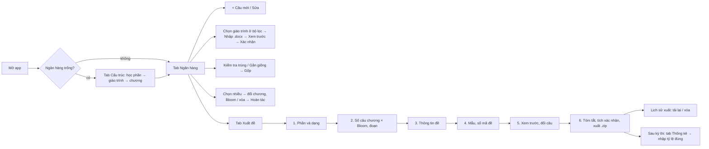

# Báo cáo kiểm thử sản phẩm QBank (2026-11-02)

Vai trò: Product Manager, UX Researcher, QA Lead, Business Analyst, Power User.
Phương pháp: đọc toàn bộ mã nguồn (`app.py`, `static/index.html`), chạy app trên CSDL trống, đi lại mọi luồng bằng trình duyệt tự động (Playwright, màn hình 1280px và 375px), gọi API trực tiếp với dữ liệu bất thường, nạp 3.000 câu để đo tốc độ. Mọi lỗi dưới đây đều đã chạy lại và thấy tận mắt, trừ khi ghi "(đọc mã)".

---

# 1. Tổng quan sản phẩm

**Mục đích.** QBank là ngân hàng câu hỏi chạy offline trên máy giảng viên: lưu câu hỏi theo Học phần → Giáo trình → Chương, phân loại theo mức Bloom và dạng câu (TN, DS, DT, TL), rồi sinh nhiều mã đề Word đúng mẫu đề của Trường ĐH Quy Nhơn, kèm đáp án.

**Mục tiêu kinh doanh (dự đoán).**
- Giảm thời gian ra một bộ đề từ vài giờ xuống khoảng 15 phút.
- Đề đúng mẫu trường, không sai đáp án, không lộ đáp án.
- Không lặp câu giữa các kỳ thi (lịch sử dùng câu).
- Có bằng chứng phân bổ Bloom và độ khó thực tế, phục vụ kiểm định chất lượng (CLO, AUN-QA).
- Tích lũy ngân hàng câu hỏi dùng chung của bộ môn tiếng Nhật.

**Người dùng chính.**
| Nhóm | Việc chính | Mức thành thạo máy tính |
|---|---|---|
| Giảng viên tiếng Nhật | Soạn câu, nhập Word, ra đề | Trung bình; quen Word, ít quen file JSON |
| Trưởng bộ môn | Duyệt cấu trúc đề, xem thống kê | Trung bình |
| Thư ký khảo thí | In đề, lưu trữ, tải lại đề cũ | Cơ bản |

**Tính năng hiện có.**
- Cấu trúc: thêm, sửa tại chỗ, xóa học phần, giáo trình, chương. Quản lý đoạn văn.
- Ngân hàng: thêm, sửa, xóa câu; lọc theo cây, bộ lọc, tìm kiếm; phân trang 50 câu; sửa và xóa hàng loạt; hoàn tác 8 giây.
- Nhập Word có xem trước từng dòng; tải mẫu nhập; sao lưu và khôi phục JSON; tự sao lưu mỗi ngày.
- Rà soát: kiểm tra trùng, gộp trùng, tự gộp trùng cùng chương, tìm câu gần giống (từ 90%).
- Thống kê: số câu theo chương × Bloom và theo dạng; nhập tỷ lệ đúng sau kỳ thi; cảnh báo câu quá dễ hoặc quá khó.
- Xuất đề: wizard 6 bước, cấu trúc đề lưu lại được, thông tin đề theo học phần, ma trận chương × Bloom, theo đoạn văn, xem trước và đổi từng câu, nhiều mã đề, xáo câu và phương án, cân bằng A/B/C/D, furigana (ruby hoặc trong ngoặc, tự sinh bằng pykakasi), đáp án ra file riêng theo mẫu trường, lịch sử xuất và tải lại.

**Sơ đồ luồng sử dụng.**

---

# 2. Chức năng đã kiểm thử

| Màn hình | Thao tác đã chạy | Kết quả |
|---|---|---|
| Ngân hàng (trống) | Mở app, "+ Câu mới", phím `N` | Chỉ có `alert` "Hãy tạo học phần…"; không có hướng dẫn bắt đầu |
| Cấu trúc | Thêm trống tên, thêm giáo trình khi chưa có học phần, thêm trùng, thêm chương không mã, hủy xóa | Chặn đúng; thông báo hiểu được. Hủy xóa vẫn báo "Đã lưu." (B16) |
| Bộ lọc | Chọn chương ở dropdown; đổi Mức, Loại; gõ tìm rồi Enter; tìm `_`, `%` | Dropdown chương hỏng (B01); Mức, Loại, Enter không tự lọc (B17); `_` `%` khớp tất cả (B18) |
| Form câu | Lưu trống, đáp án E khi có 4 phương án, trùng cùng chương, DS sai số ý, DS chữ thường, TL có đáp án, 9 phương án | Kiểm tra tốt; TL mất đáp án (B08); 9 phương án lưu được nhưng làm hỏng xuất đề (B03) |
| Nhập Word | File PDF đổi đuôi, file rỗng, thiếu cột, 24 dòng bẩn, 3.000 dòng | Xem trước tốt; lỗi kỹ thuật thô (B19, B20); mức chữ thành 1 (B07); trùng giả (B05); 3.000 câu: kiểm tra 3 s, ghi 11 s |
| Rà soát | Kiểm tra trùng, gần giống với 3.000 câu | Gần giống mất 42 s, không có chỉ báo đang chạy (B06) |
| Sửa và xóa | Sửa câu đã bị xóa ở tab khác; sửa thành câu trùng; đổi chương | Báo "Đã lưu câu (đã xóa)" (B10); tạo được trùng (B09); mã câu giữ chương cũ (B22) |
| Xuất đề | Đi đủ 6 bước; ô vượt số câu; số âm, số lẻ; thông tin đề sai kiểu; bắt đầu từ 0; xem trước, đổi câu; xuất 2 lần liền; 100 mã đề | Chặn ô thiếu tốt; thông tin đề không kiểm tra (B15); bắt đầu từ 0 thành 001 (B13); xuất lần 2 dùng lại câu cũ (B12); 100 mã đề mất 12 s, mỗi câu thành "đã dùng 100 lần" (B11) |
| File Word | Mở đề và đáp án | Đúng mẫu, đáp án lưới 10 câu, cân bằng A–D; "(Đề thi gồm: __ Trang)" luôn trống (B14) |
| Thống kê | Ghi kết quả thiếu mã đề, dữ liệu trộn lỗi, dán dạng tab, bấm 2 lần | Báo lỗi từng dòng tốt; không nhận dữ liệu dán từ Excel; ghi lặp bị cộng dồn (B26) |
| Sao lưu | Sao lưu rồi khôi phục sang máy mới | Mất mã câu, mã học phần, lịch sử dùng, kết quả thi, cấu trúc đề, lịch sử xuất (B02) |
| Bảo mật | POST `text/plain` có `Origin: https://evil.example`; template `../app.py`; tiền tố `../../evil` | CSRF xóa được câu (B04); template bị chặn đúng; tiền tố lọt vào tên mục zip (B25); XSS được escape đúng |
| Responsive | 375px: Ngân hàng, Xuất đề bước 2, Thống kê | Ngân hàng rộng 608px, cuộn ngang (B29); bước 2 vừa màn hình |
| Điều hướng | F5 giữa wizard; nút Back | Mất cấu trúc đề đang soạn, quay về tab Ngân hàng; Back thoát app (B30) |

**Điểm tốt nên giữ.** Nhập Word có xem trước trước khi ghi. Wizard kiểm tra từng bước. Xem trước và đổi từng câu. Hoàn tác khi xóa. Cân bằng đáp án A/B/C/D. Bảng bước 2 chỉ vẽ dòng đang nhìn thấy nên chịu được nhiều chương. Escape HTML đúng ở mọi chỗ đã thử. Chặn đường dẫn template ra ngoài thư mục.

---

# 3. Lỗi phát hiện (Bugs)

Mức độ: **Critical** = mất dữ liệu, sập chức năng chính hoặc lỗ hổng bảo mật; **High** = sai kết quả nghiệp vụ; **Medium** = sai nhưng có cách tránh; **Low** = khó chịu hoặc hiếm gặp.

| ID | Mức | Lỗi | Cách tái hiện | Vị trí |
|---|---|---|---|---|
| B01 | Critical | Chọn chương ở dropdown lọc làm bảng trống "0–0 của 0" | Ngân hàng → chọn học phần, giáo trình → chọn một chương ở dropdown. Request `page=NaN` trả 400. Người dùng tưởng chương không có câu | `index.html:388` (`onchange = loadQuestions` truyền Event làm số trang) |
| B02 | Critical | Sao lưu JSON thiếu dữ liệu, kể cả bản tự sao lưu hằng ngày | Sao lưu → khôi phục vào app mới: `N4-MN1-B01-001` thành `HP1-GT1-B01-001`; mất mã HP/GT, lịch sử dùng câu, kết quả thi, cấu trúc đề, lịch sử xuất, thông tin đề, chương chưa có câu | `app.py:1272` `backup_payload` |
| B03 | Critical | Câu TN hơn 8 phương án làm hỏng xuất đề | Lưu câu 9 phương án → xuất phần có câu đó → "IndexError: string index out of range" | `app.py:327` không giới hạn; `LETTERS` chỉ 8 chữ |
| B04 | Critical | CSRF: trang web bất kỳ đang mở trong trình duyệt có thể xóa hoặc chèn dữ liệu | `POST /api/questions/bulk-delete` với `Content-Type: text/plain`, `Origin` lạ → xóa thành công. Id tăng dần nên dễ đoán | `app.py` `Handler` không kiểm tra Origin, Host hay Content-Type |
| B05 | Critical | So trùng bỏ mọi ký tự không phải chữ hoặc số nên báo trùng sai và bỏ qua câu khi nhập Word | "1+1=?" và "1-1=?" (cùng phương án) bị coi là trùng, dòng 2 bị bỏ qua. Câu cùng nội dung khác đáp án cũng bị coi là trùng | `app.py:438` `dup_key` |
| B06 | High | "Tìm câu gần giống" so từng cặp | 3.000 câu: 42 s, không có chỉ báo đang chạy. 18.000 câu ước tính trên 20 phút | `app.py:1321` |
| B07 | High | Nhập Word: cột Mức ghi chữ ("Hiểu") hoặc để trống được nhập thành mức 1, không báo | File bẩn dòng 5 | `app.py:561` |
| B08 | High | Đáp án hoặc gợi ý chấm của câu Tự luận bị xóa lặng lẽ | Form hoặc Word: TL có Đáp án "Gợi ý: nêu 3 ý" → lưu xong đáp án rỗng; file đáp án in "TL" | `app.py:341` |
| B09 | High | Sửa câu tạo được câu trùng trong cùng chương (Thêm thì bị chặn) | Sửa câu 2 thành nội dung câu 1 → lưu được; "Kiểm tra trùng" thấy nhóm mới | `app.py:1734` PUT không kiểm tra trùng |
| B10 | High | Lưu câu đã bị xóa ở tab khác vẫn báo thành công | Tab A mở Sửa, tab B xóa câu, tab A bấm Lưu → toast "Đã lưu câu (đã xóa)."; nội dung sửa mất | `app.py:1739` không kiểm tra số dòng cập nhật |
| B11 | High | Số lần dùng nhân theo số mã đề | Một lần xuất 100 mã đề → mỗi câu "đã dùng 100 lần" | `app.py:1835` |
| B12 | High | Xuất lần hai khi còn bản xem trước dùng lại đúng các câu cũ và báo sai lý do | Xuất xong bấm Xuất lần nữa → cùng câu, thông báo "ngân hàng thiếu câu mới" dù còn 3.000 câu; ô xác nhận vẫn tích | `index.html:1530`, `1551` |
| B13 | Medium | "Bắt đầu từ" = 0 bị đổi thành 1; tóm tắt hiện GK0 nhưng file là GK001 | Bước 4 nhập 0 | `index.html:1535` (`+v \|\| 1`) |
| B14 | Medium | "(Đề thi gồm: __ Trang)" luôn trống trên mẫu chính thức | Mọi lần xuất; `{{SO_TRANG}}` không có ô nhập | `app.py:958`, form bước 3 |
| B15 | Medium | Thông tin đề không được kiểm tra | Số tín chỉ "abc", thời gian "-90", học kỳ "9" in thẳng lên đề | Bước 3 |
| B16 | Low | Hủy xóa ở tab Cấu trúc vẫn báo "Đã lưu." | Bấm Xóa → Hủy | `index.html:905` |
| B17 | Low | Bộ lọc không nhất quán | Enter ở ô tìm không lọc; đổi Mức/Loại không tự lọc, trong khi đổi Học phần/Giáo trình thì tự lọc | `index.html:386-388` |
| B18 | Low | Tìm `_` hoặc `%` khớp mọi câu | Câu điền từ hay có `___` | `app.py:1535` LIKE không escape |
| B19 | Low | Thông báo lỗi kỹ thuật | File PDF đổi đuôi: "BadZipFile: File is not a zip file"; JSON sai: "Expecting property name…" | `app.py:1496` |
| B20 | Low | Thiếu cột báo bằng tên nội bộ | "thiếu cột dap_an, muc" | `app.py:526` |
| B21 | Low | Không xóa được chương còn đoạn văn mồ côi, thông báo không nhắc đoạn văn | Xóa câu cuối có đoạn → xóa chương → "Còn dữ liệu bên trong (câu hỏi, giáo trình hoặc chương)" | `app.py:1770` |
| B22 | Low | Đổi chương giữ mã chương cũ | Câu chuyển sang B03 vẫn mang mã `N4-MN1-B01-003` | Thiết kế mã "không đổi" |
| B23 | Low | Đáp án Đúng/sai hiện mã nội bộ "DDD" thay vì "ĐĐĐ" | Bảng ngân hàng, xem trước | `index.html:453`, `1401` |
| B24 | Low | Tên file thừa chữ "De" | Bỏ trống Mã HP → `De_De_GK001-GK002_…zip` | `app.py:174` |
| B25 | Low | Tiền tố mã đề không lọc ký tự | Tiền tố `../../evil`, bắt đầu -5 → mục zip `De_../../evil-05.docx` | `app.py:1781` |
| B26 | Low | Nhập kết quả không nhận dữ liệu dán từ Excel và cộng dồn khi ghi lại | Dòng cách bằng Tab hoặc `;` bị báo lỗi; ghi lại cùng mã đề thành "2 lần" | `index.html:670`, `app.py:1169` |
| B27 | Low | Nhập Word: đoạn văn khác một dấu câu tạo đoạn mới, không cảnh báo (form thì có) | Dòng 17 file bẩn | `app.py:581` |
| B28 | Medium | Bấm "Sửa" tải cả ngân hàng để lấy một câu | 3.000 câu: 1,6 MB mỗi lần; 18.000 câu khoảng 10 MB. Gộp trùng cũng vậy | `index.html:516`, `653` |
| B29 | Medium | Màn hình 375px: trang rộng 608px, phải cuộn ngang; câu dài 5.000 ký tự hiện hết trong bảng | Mở trên điện thoại | CSS bảng ngân hàng |
| B30 | Medium | F5 mất cấu trúc đề đang soạn và quay về tab Ngân hàng; nút Back thoát app | Bước 2 nhập số → F5 | Không có định tuyến, không lưu nháp |
| B31 | Low | Lịch sử xuất lưu nguyên file zip trong CSDL, không dọn | 100 mã đề: 3,3 MB một lần | `app.py:1839` |
| B32 | Low | Việc lâu không có tiến trình | Xuất 100 mã: 12 s; khôi phục 3.000 câu: 26 s; nút vẫn bấm được | Giao diện |

---

# 4. Pain points của người dùng (theo vai trò)

**Senior PM: "Lần đầu dùng có ra được đề trong 15 phút không?"** Không. Màn hình trống chỉ có 5 hàng nút; bấm "+ Câu mới" chỉ được một `alert`. Phải tự đoán thứ tự Cấu trúc → Ngân hàng → Xuất đề. Dễ học: 6/10.

**UX Researcher: chỗ gây nhầm lẫn.**
1. Nhập Word bị khóa cho tới khi chọn giáo trình ở *bộ lọc*: ràng buộc ẩn, chỉ báo bằng chữ đỏ nhỏ.
2. Hai bộ điều hướng (cây bên trái và 3 dropdown) làm cùng một việc nhưng chạy khác nhau: cây chạy đúng, dropdown chương hỏng (B01).
3. Câu hiện cú pháp thô `{試験|しけん}` thay vì furigana.
4. Đáp án Đúng/sai hiện "DDD".
5. Bước 2 hiện cả 4 phần chồng lên nhau; phần không dùng vẫn chiếm chỗ.
6. "Mã đề" ở tab Thống kê là đợt thi, khác "mã đề" ở tab Xuất đề.
7. Mã câu `HP1-GT1-…` xuất hiện khi chưa đặt mã học phần, khó đọc và không đổi lại được.

**QA Lead: rủi ro cao nhất.** Bảng trống sai (B01) khiến người dùng nhập lại câu đã có. Bản sao lưu không đủ để phục hồi (B02). Đề hỏng ngay lúc cần in (B03). Một trang web độc hại có thể xóa ngân hàng (B04).

**Business Analyst: quy tắc nghiệp vụ chưa rõ.**
- Một lần xuất nhiều mã đề có tính là nhiều lần dùng không? (B11)
- Câu Tự luận cần đáp án và thang điểm; hiện bị bỏ (B08).
- Trùng là trùng nội dung hay trùng cả đáp án? Hiện bỏ cả dấu toán học (B05).
- Đổi chương có đổi mã câu không? (B22)
- Kết quả thi nhập lại cho cùng đợt là thay thế hay cộng dồn? (B26)

**Power User (18.000 câu, 10 học phần).**
- "Gần giống" không dùng được (B06). "Sửa" chậm dần (B28).
- Chọn hàng loạt chỉ trong trang 50 câu; không có "chọn mọi câu khớp bộ lọc".
- Không có phím tắt lưu rồi thêm câu tiếp. Không có thẻ (tag) để lọc theo chủ điểm ngữ pháp.
- Ra đề định kỳ cần sao chép cả cấu trúc lẫn thông tin đề; F5 làm mất công (B30).

**Bước thừa.**
- Bước 3 hỏi xác nhận bằng hộp thoại trình duyệt, rồi bước 6 lại phải tích ô xác nhận.
- Phải chọn học phần ở bước 3 để điền thông tin, dù bước 2 đã chọn học phần.
- Nhập Word: chọn giáo trình ở bộ lọc → chọn file → xem trước → xác nhận. Có thể chọn giáo trình ngay trong khung xem trước.
- Sau "Lưu" form đóng lại, muốn thêm câu tiếp phải bấm "+ Câu mới" và chọn lại chương, loại.

---

# 5. Đánh giá UX/UI

| Tiêu chí | Điểm | Lý do |
|---|---|---|
| Dễ học (Learnability) | 6/10 | Có hướng dẫn chữ ở mọi bước, wizard có số bước; nhưng không có màn hình bắt đầu, thuật ngữ nhiều, ràng buộc ẩn khi nhập Word |
| Dễ sử dụng (Usability) | 6/10 | Xem trước nhập, hoàn tác, đổi câu rất tốt; bộ lọc hỏng và hành vi không đều kéo điểm xuống |
| Tính nhất quán | 5/10 | Lưu: chỗ toast, chỗ chữ dưới nút, chỗ `alert`. Thêm chặn trùng, Sửa không chặn. Lọc: chỗ tự chạy, chỗ phải bấm "Lọc" |
| Tốc độ thao tác | 6/10 | Thao tác thường dưới 0,1 s; "gần giống", khôi phục, xuất nhiều mã chậm và không có tiến trình |
| Giao diện | 5/10 | Sạch nhưng dày đặc; 5 hàng nút trước khi thấy dữ liệu; ô chọn file mặc định của trình duyệt; không có trên điện thoại |
| Trải nghiệm tổng thể | 6/10 | Đủ nghiệp vụ, đi đúng hướng; cần sửa các lỗi Critical trước khi đưa cho giảng viên khác |

---

# 6. Cơ hội cải tiến

## Top 10 cải tiến UI
1. Thanh công cụ Ngân hàng gọn: một nút "+ Câu mới" chính, gom Nhập/Sao lưu/Khôi phục vào menu "Dữ liệu", Rà soát vào menu "Rà soát"; thanh hàng loạt chỉ hiện khi đã chọn câu.
2. Form câu mở thành panel bên phải hoặc hộp nổi, không đẩy danh sách.
3. Hiển thị furigana bằng `<ruby>` trong danh sách, xem trước và form.
4. Đáp án TN chọn bằng nút radio cạnh từng phương án, có nút thêm hoặc bớt phương án (tối đa 8).
5. Bảng ngân hàng dạng thẻ trên màn hình hẹp; cắt nội dung dài, bấm để mở rộng.
6. Nút chọn file dạng vùng kéo thả có nhãn rõ, thay ô "Choose File".
7. Đáp án DS hiện "Đ S Đ"; nhãn dạng câu viết đủ ("Trắc nghiệm").
8. Bước 2 dạng tab theo phần, mỗi lần một phần; thanh tổng cố định "Đề: 40 câu (TN 30, TL 10)".
9. Chỉ báo đang tải (spinner, khóa nút) cho nhập Word, khôi phục, gần giống, xuất đề.
10. Lịch sử xuất: hiện khoảng mã "001–100" thay vì liệt kê 100 mã; thêm cột học phần.

## Top 10 cải tiến UX
1. Màn hình bắt đầu 3 bước (tạo học phần → nhập câu → xuất đề), kèm tải mẫu và nút nạp dữ liệu mẫu.
2. Chọn giáo trình đích ngay trong luồng nhập Word, không phụ thuộc bộ lọc.
3. Bộ lọc nhất quán: mọi thay đổi tự lọc, Enter để tìm, bỏ nút "Lọc"; lưu bộ lọc lên URL.
4. "Lưu và thêm câu tiếp" (Ctrl+Enter) giữ chương, Bloom, loại.
5. Lưu nháp wizard xuất đề (localStorage) và định tuyến theo URL (`#export/2`) để F5 và Back không mất việc.
6. Sau khi xuất: xóa bản xem trước, bỏ tích xác nhận, hiện nút "Xuất đợt mới".
7. Thông báo lỗi bằng tiếng Việt cho mọi lỗi kỹ thuật (file sai định dạng, số không hợp lệ).
8. Mã chương khi nhập Word không phân biệt hoa/thường và gợi ý mã gần đúng ("B1 → B01?").
9. Kiểm tra thông tin đề ở bước 3 (số, khoảng hợp lệ), thêm ô số trang.
10. Nhập kết quả thi: nhận dán từ Excel (Tab, `;`, `,`), hoặc tải file; ghi lại cùng đợt thì hỏi thay thế.

---

# 7. Đề xuất tính năng mới

## Top 10 tính năng nên bổ sung
1. **Sao lưu và khôi phục đầy đủ**: tải file `.db` hoặc JSON phiên bản 3 có mọi bảng; khôi phục từ bản tự sao lưu ngay trong app; chế độ "thay thế" bên cạnh "thêm vào".
2. **Thùng rác (xóa mềm)** thay cho hoàn tác 8 giây.
3. **Đáp án và thang điểm cho câu Tự luận**; điểm từng câu, từng phần; tổng điểm in trên đề.
4. **Xem trước bản in** (render file Word thành HTML hoặc PDF) trước khi xuất.
5. **Bảng đặc tả đề thi** (blueprint): ma trận CLO × Bloom × số câu × điểm, xuất kèm đề cho hồ sơ kiểm định.
6. **Nhập Excel/CSV và dán từ clipboard**, vì nhiều giảng viên soạn câu trong Excel.
7. **Hình ảnh và âm thanh trong câu** (nghe hiểu, chữ viết tay, tranh minh họa).
8. **Thẻ (tag)** tự do: chủ điểm ngữ pháp, cấp JLPT, kỹ năng; lọc và đặt ma trận theo thẻ.
9. **Phân tích câu hỏi từ file chấm**: nhập bảng điểm từng sinh viên → độ khó, độ phân biệt, phương án nhiễu kém.
10. **Trạng thái câu và người duyệt**: Nháp → Đã duyệt → Ngưng dùng; chỉ câu đã duyệt được ra đề; ghi ai sửa gì.

Xem xét thêm: cấu hình tên trường và khoa (README đã nêu); xuất Moodle XML hoặc QTI cho thi trực tuyến; chạy trên mạng nội bộ có đăng nhập để cả bộ môn dùng chung.

## Top 5 tính năng nên loại bỏ hoặc gộp
1. **Bộ 3 dropdown Học phần/Giáo trình/Chương**: trùng với cây bên trái, đang là nguồn lỗi (B01). Chỉ giữ cây; trên màn hình hẹp cây thu thành một dropdown.
2. **"Kèm đáp án cuối đề"**: dễ in nhầm đề có đáp án. Đã có đáp án file riêng; chuyển vào mục nâng cao hoặc bỏ.
3. **Hai mẫu demo `mau_chuan.docx`, `mau_gon.docx` tự tạo**: làm rối danh sách mẫu khi đã có mẫu trường.
4. **"Tự gộp trùng trong cùng chương" chạy ngay, không hoàn tác**: gộp vào "Kiểm tra trùng", có xem trước và hoàn tác.
5. **Bốn phần mặc định TN/DS/DT/TL tự thêm**: thay bằng chọn cấu trúc đã lưu hoặc một phần trống.

---

# 8. Roadmap ưu tiên

| Ưu tiên | Việc | Lý do |
|---|---|---|
| **Critical** (làm ngay) | B01 sửa dropdown chương; B02 sao lưu đầy đủ; B03 giới hạn 8 phương án và kiểm tra trước khi xuất; B04 chặn CSRF (kiểm tra Origin/Host, chỉ nhận `application/json`, token phiên); B05 so trùng giữ ký hiệu và đáp án | Mất dữ liệu, sập xuất đề, bảo mật |
| **High** (1–2 tuần) | B06 tăng tốc "gần giống" (n-gram/MinHash, chạy nền, có tiến trình); B07, B08 không đoán mức, giữ đáp án TL; B09, B10 kiểm tra khi sửa; B11 tính dùng theo lần xuất; B12 xóa xem trước sau khi xuất; B28 API lấy một câu; màn hình bắt đầu | Sai số liệu nghiệp vụ, hiệu năng |
| **Medium** (1 tháng) | B13, B14, B15 thông tin đề; B29 responsive; B30 lưu nháp wizard và định tuyến; panel sửa câu, ruby, radio đáp án; nhập Excel; thùng rác; đáp án và điểm TL | Trải nghiệm hằng ngày |
| **Low** (sau) | B16–B27, B31, B32; thẻ; bảng đặc tả; xem trước bản in; phân tích câu hỏi; trạng thái duyệt; Moodle XML; nhiều người dùng | Hoàn thiện, mở rộng |

---

# 9. Kết luận

QBank đã giải đúng bài toán: ra nhiều mã đề đúng mẫu trường, cân bằng Bloom và đáp án, tránh lặp câu. Các phần khó (xem trước nhập, đổi câu, hoàn tác, cân bằng A–D) làm tốt. Trước khi phát cho giảng viên khác cần sửa 5 lỗi Critical: bảng trống sai khi lọc chương, sao lưu thiếu dữ liệu, đề hỏng khi có hơn 8 phương án, CSRF, và so trùng sai làm mất câu khi nhập. Sau đó là hiệu năng ở quy mô hàng chục nghìn câu và màn hình bắt đầu cho người mới.

## Danh sách Bugs
B01–B32 ở mục 3: 5 Critical, 7 High, 6 Medium, 14 Low.

## Danh sách UX Issues
1. Không có màn hình bắt đầu; chỉ `alert` khi chưa có chương.
2. Thanh công cụ Ngân hàng 5 hàng, trộn nhiều nhóm việc.
3. Nhập Word phụ thuộc giáo trình chọn ở bộ lọc (ràng buộc ẩn).
4. Form sửa chèn giữa trang, đẩy danh sách; không có "lưu và thêm tiếp".
5. Đáp án TN gõ bằng chữ thay vì chọn.
6. Furigana hiện cú pháp thô.
7. Mã chương phân biệt hoa/thường, phải khớp tuyệt đối.
8. Dòng lỗi trong xem trước nhập Word không hiện nội dung để dò.
9. Bước 2 hiện mọi phần chồng nhau; không có tổng số câu cả đề.
10. Xác nhận hai lần (hộp thoại bước 3 và ô tích bước 6).
11. Toast lỗi cũ còn hiện khi đã sang bước khác.
12. Chọn hàng loạt chỉ trong trang hiện tại.
13. Thống kê chỉ là bảng số, không lọc theo học phần, không biểu đồ.
14. "Mã đề" mang hai nghĩa khác nhau ở hai tab.
15. Khôi phục luôn thêm vào, không có chế độ thay thế; dễ nhân đôi câu ở chương khác.
16. Không có tiến trình cho việc lâu; nút vẫn bấm được nên dễ gửi hai lần.

## Danh sách Missing Features
Sao lưu đầy đủ; thùng rác; đáp án và điểm cho Tự luận; xem trước bản in; bảng đặc tả đề; nhập Excel/CSV và dán; hình ảnh, âm thanh; thẻ; phân tích câu hỏi từ bảng điểm; trạng thái duyệt câu; cấu hình trường và khoa; xuất Moodle/QTI; dùng chung qua mạng nội bộ.

## Top 20 đề xuất cải tiến giá trị cao nhất

| # | Đề xuất | Tác động ước tính | Công sức |
|---|---|---|---|
| 1 | Sửa dropdown chương (B01) | Hết hiểu nhầm "chương trống", tránh nhập trùng; ảnh hưởng mọi người dùng | 1 dòng |
| 2 | Sao lưu và khôi phục đầy đủ (B02) | Phục hồi được 100% dữ liệu khi hỏng máy; giữ mã câu cho nhập kết quả thi | Thấp (cho tải file `.db`) |
| 3 | Chặn CSRF (B04) | Loại rủi ro mất toàn bộ ngân hàng từ một trang web lạ | Thấp |
| 4 | Giới hạn 8 phương án, kiểm tra trước khi xuất (B03) | Không còn đề hỏng lúc cần in | Thấp |
| 5 | So trùng giữ ký hiệu và đáp án (B05) | Không mất câu khi nhập; hết báo trùng giả | Thấp |
| 6 | Màn hình bắt đầu và dữ liệu mẫu | Người mới ra đề đầu tiên dưới 15 phút; giảm hỗ trợ | Thấp |
| 7 | Tăng tốc "gần giống", chạy nền (B06) | Từ 42 s (3.000 câu) xuống vài giây; dùng được ở 18.000 câu | Trung bình |
| 8 | Giữ đáp án và thêm điểm cho Tự luận (B08) | Đáp án đề hoàn chỉnh, không phải soạn tay | Trung bình |
| 9 | Đếm "đã dùng" theo lần xuất (B11) và xóa xem trước sau xuất (B12) | Ưu tiên câu mới chính xác; tránh hai đợt đề giống nhau | Thấp |
| 10 | Kiểm tra trùng và tồn tại khi sửa (B09, B10) | Không mất bài sửa, không trùng ngầm | Thấp |
| 11 | Nhập Word: báo lỗi Mức/Loại thay vì đoán; mã chương không phân biệt hoa/thường (B07) | Giảm câu sai mức Bloom làm lệch ma trận | Thấp |
| 12 | Chọn giáo trình ngay trong luồng nhập Word | Bớt 1 bước và 1 ràng buộc ẩn | Thấp |
| 13 | API lấy một câu cho "Sửa" (B28) | Mở form tức thì ở mọi quy mô | Thấp |
| 14 | Ô số trang và kiểm tra thông tin đề (B14, B15) | Đề đúng mẫu hành chính, không phải sửa tay | Thấp |
| 15 | Lưu nháp wizard, định tuyến URL (B30) | Không mất 10–15 phút soạn ma trận khi lỡ F5 | Trung bình |
| 16 | Panel sửa câu, chọn đáp án bằng radio, xem furigana | Soạn câu nhanh hơn khoảng 30%, ít sai đáp án | Trung bình |
| 17 | "Lưu và thêm câu tiếp", bộ lọc tự chạy, Enter để tìm | Bớt 2–3 thao tác mỗi câu | Thấp |
| 18 | Nhập Excel/CSV và dán kết quả thi từ Excel | Mở cho giảng viên soạn bằng Excel; nhập kết quả trong vài giây | Trung bình |
| 19 | Thùng rác thay hoàn tác 8 giây | Phục hồi xóa nhầm phát hiện muộn | Trung bình |
| 20 | Responsive cho màn hình hẹp (B29) | Tra cứu, duyệt câu trên điện thoại hoặc máy tính bảng | Trung bình |
